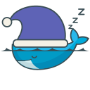
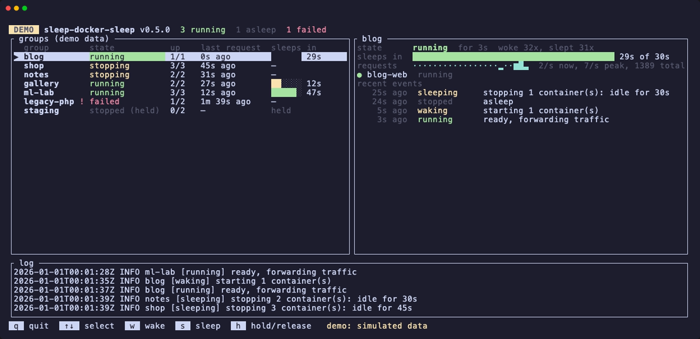
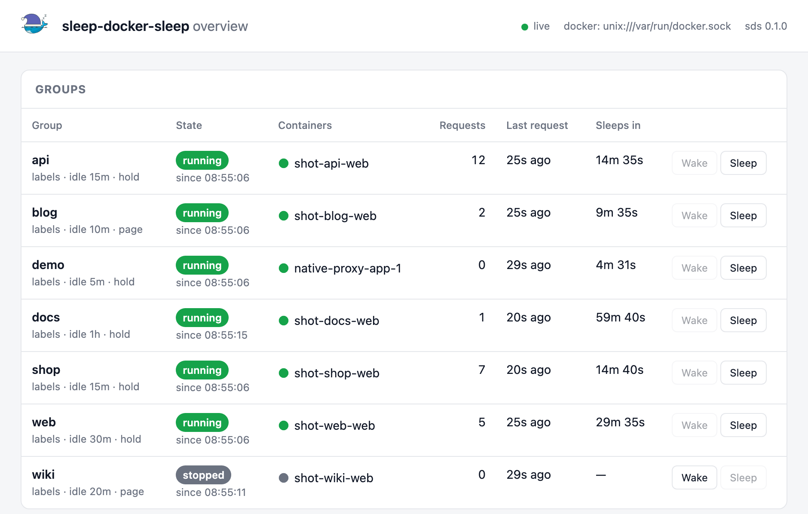

<p align="center">
  
</p>

<h1 align="center">sleep-docker-sleep</h1>

<p align="center">
  <b>Stops Docker containers nobody is using and wakes them on the first request.</b><br>
  One Rust binary, no changes to your applications, works with the reverse proxy you already run.
</p>

<p align="center">
  <a href="https://github.com/altipard/sleep-docker-sleep/releases"></a>
  <a href="https://github.com/altipard/sleep-docker-sleep/actions/workflows/ci.yml"></a>
  <a href="https://altipard.github.io/sleep-docker-sleep/"></a>
  <a href="https://github.com/altipard/sleep-docker-sleep/pkgs/container/sleep-docker-sleep"></a>
  <a href="LICENSE"></a>
</p>

<p align="center">
  
</p>

## Install

Linux (any distribution, the binaries are static) and macOS, x86_64 and aarch64. Needs Docker
Engine 20.10 or newer and access to the Docker socket.

```bash
curl -fsSL https://raw.githubusercontent.com/altipard/sleep-docker-sleep/main/install.sh | sh
```

The installer verifies the release and installs to `/usr/local/bin`, or to `~/.local/bin` if
that is not writable. Look around first, without Docker or a daemon: `sds top --demo`.

<details>
<summary>specific version, verification, by hand, cargo or container</summary>

<br>

**Installer options.** `SDS_INSTALL_DIR` sets the target directory, `SDS_VERSION` a release to
install instead of the latest (0.4.1 and later). The signature check needs OpenSSL 3. Without it (stock macOS ships
LibreSSL), the installer checks the release's `SHA256SUMS` instead and says so; 0.4.1 has no
`SHA256SUMS` and needs OpenSSL 3 (`brew install openssl`).

**Release binary by hand** (same files), including an Ed25519 signature and the release
public key (needs OpenSSL 3 as well):

```bash
base=https://github.com/altipard/sleep-docker-sleep/releases/latest/download
curl -fsSLo sds "$base/sds-linux-x86_64"
curl -fsSLo sds.sig "$base/sds-linux-x86_64.sig"
curl -fsSLo sds-release-public-key.pem "$base/sds-release-public-key.pem"
openssl pkeyutl -verify -rawin -pubin -inkey sds-release-public-key.pem -in sds -sigfile sds.sig
sudo install -m 755 sds /usr/local/bin/sds
```

`sds update` performs this signature verification automatically before executing or
installing a downloaded binary, and keeps the previous binary as `sds.previous`.

**Cargo** (Rust 1.88+):

```bash
cargo install --git https://github.com/altipard/sleep-docker-sleep --locked
```

**Container** (when your reverse proxy runs as a container too; set
`[admin] bind = "0.0.0.0:9900"` and an `admin.token` in the mounted `sds.toml`):

```bash
docker run -d --name sds \
  -v /var/run/docker.sock:/var/run/docker.sock \
  -v ./sds.toml:/etc/sds/sds.toml:ro \
  -p 127.0.0.1:9900:9900 \
  ghcr.io/altipard/sleep-docker-sleep:latest
```

</details>

> [!TIP]
> `sds check` verifies Docker access and lists the groups it would manage, without
> starting the daemon. Run it first.

## Contents

- [Why I built this](#why-i-built-this)
- [Quick start](#quick-start)
- [What you get](#what-you-get)
- [How it works](#how-it-works)
- [Try it with the demo stack](#try-it-with-the-demo-stack)
- [How it compares](#how-it-compares)
- [Documentation](#documentation)
- [Status](#status)
- [Development](#development)
- [Acknowledgements](#acknowledgements)
- [License](#license)

## Why I built this

As a developer you tend to have more Docker containers running than you actually need. `sds`
brings some order to that: what nobody uses goes to sleep, what somebody needs is back on the
first request. The same holds for hosts with many rarely used stacks: staging environments,
customer demos, internal tools, side projects.

The idea came from pandiloko, see [Acknowledgements](#acknowledgements).

## Quick start

1. Label a project and publish its port on loopback only:

   ```yaml
   services:
     app:
       image: ghcr.io/example/app:1.2.3
       ports: ["127.0.0.1:18080:8080"]
       labels:
         sds.enable: "true"
         sds.idle_timeout: "15m"
         sds.health: "http://127.0.0.1:18080/healthz"
   ```

2. Run the daemon and generate the proxy snippet:

   ```bash
   sds run                                       # dashboard; `sds service install` for production
   sds integrate nginx myproject --host app.example.com --upstream http://127.0.0.1:18080
   ```

   The command prints a ready-to-use `server` block (a Caddyfile block or Traefik
   middleware for the others). Reload the proxy.

3. Watch the cycle: `sds sleep myproject` stops the project, a browser reload wakes it.

> [!NOTE]
> One `sds` per host manages every labelled container on it. Two daemons on the same
> Docker socket would fight over the same groups.

## What you get

### See why a group is awake and when it will sleep

`sds top` attaches to the running daemon: state, containers, last request and a countdown per
group, plus health, recent events and a request sparkline for the selected one. `w` wakes,
`s` sleeps, `h` holds a group down for maintenance.

<p align="center">
  
</p>

### The same in the browser

The web overview at `http://127.0.0.1:9900/` shows groups, counters and the event log live,
with buttons for wake, sleep, hold and release.

<p align="center">
  
</p>

### Containers opt in with a label

`sds.enable=true` is enough; a Compose project forms a group automatically. There is no
central inventory to maintain, and Compose is not required
([`docker run` example](docs/handbook/labels.md#example-plain-docker-run-without-compose)).

<details>
<summary>the most important labels</summary>

<br>

| Label | Default | Meaning |
|---|---|---|
| `sds.enable` | | `true` puts the container under management. |
| `sds.group` | Compose project | Containers with the same group start and stop together. |
| `sds.idle_timeout` | `15m` | Stop the group after this long without a request. |
| `sds.health` | `docker` | Readiness after a start: `docker` (HEALTHCHECK), `http://…`, `tcp://host:port`, `grace`. |
| `sds.wake` | `hold` | `hold` the first request until ready, or serve a waiting `page`. |
| `sds.keep_awake` | `false` | Never stop this group (databases shared by several stacks). |
| `sds.proxy.listen` | | Let `sds` own a public port itself, see [native proxy](docs/handbook/native-proxy.md). |

Defaults live in `sds.toml`; labels override them per group. The full list is in the
[labels chapter](docs/handbook/labels.md).

</details>

### Your reverse proxy stays in charge

nginx, Caddy or Traefik ask `sds` before each request via their built-in forward-auth. `sds`
never carries application traffic, so it cannot become a bottleneck. `sds integrate` prints
the ready-to-use snippet:

```bash
sds integrate nginx shop --host shop.example.com --upstream http://127.0.0.1:18080
sds integrate caddy shop --host shop.example.com --upstream http://127.0.0.1:18080
sds integrate traefik shop --upstream http://shop:8080 --sds-url http://sds:9900
```

With nginx a crash of `sds` fails open: the site stays up, only sleeping stops. Caddy and
Traefik have no fail-open for forward-auth; run `sds` as a supervised service with automatic
restart. Details are in the [reverse proxy chapter](docs/handbook/reverse-proxy.md), complete
setups under [`examples/`](examples/README.md).

### Wake-ups that wait for healthy

Requests are held until the group is healthy (Docker HEALTHCHECK, HTTP or TCP probe), or a
self-refreshing waiting page is served. Waiters are bounded and a group starts only once, no
matter how many requests arrive.

### And more

- **[Native proxy](docs/handbook/native-proxy.md):** for stacks without a reverse proxy and
  for TCP services such as databases, `sds` can own the public port itself (streaming,
  WebSocket aware).
- **Scripting:** `sds status --json`, `sds wake --wait`, `sds sleep`, `sds hold`,
  `sds release`.
- **[HTTP API](docs/handbook/api.md):** JSON, server-sent events, OpenAPI spec and Swagger UI
  at `/docs`.
- **Service units:** `sds service install` writes the systemd unit or launchd plist.
- **Signed updates:** `sds update` verifies and installs the latest release in place and keeps
  the previous binary for rollback.

All commands are in the [operations chapter](docs/handbook/operations.md).

## How it works

```text
browser ──▶ reverse proxy ──(forward-auth: /_sds/check/shop)──▶ sds ──▶ docker start / stop
                 │                                                            │
                 └──────────────── request ────────────────▶ container group "shop" ◀┘
```

1. Before each request the proxy asks `GET /_sds/check/<group>`.
2. If the group is running, `sds` answers `200` and records the activity.
3. If it is asleep, `sds` starts the containers and holds the request, or answers with the
   waiting page.
4. Without a request for `sds.idle_timeout`, `sds` stops the group.

Only requests that pass through your reverse proxy or the native proxy count as activity. What `sds` does not do is listed
in [Limitations](docs/handbook/limitations.md).

## Try it with the demo stack

[`examples/demo`](examples/demo/README.md) starts ten tiny web servers with idle timeouts
between 20 and 60 seconds and a script that sends random requests through `sds`. Within a
minute the dashboard shows groups falling asleep, waking on a request and serving again.

```bash
cd examples/demo
docker compose up -d
sds run          # second terminal
./traffic.sh     # third terminal
```

## How it compares

| | sleep-docker-sleep | Sablier | Lazytainer |
|---|---|---|---|
| Integration | forward-auth of nginx/Caddy/Traefik, or native proxy | proxy plugins (Traefik, Caddy, nginx, …) | own proxy / iptables |
| Discovery | container labels, Compose project = group | proxy configuration per route | labels |
| Wake behaviour | hold or waiting page, bounded waiters | waiting page themes | hold |
| Health gating | Docker HEALTHCHECK, HTTP, TCP, grace | container running | TCP |
| Operator UI | CLI, TUI, web overview, API | none | none |
| Language | Rust | Go | Go |

The design goal was production stability on hosts with a mix of host-level and
per-project proxies, which is why `sds` stays out of the data path by default. See
[Limitations](docs/handbook/limitations.md) for the honest list of what it does not do.

## Documentation

The [handbook](https://altipard.github.io/sleep-docker-sleep/) covers installation,
the configuration reference, labels and groups, per-proxy integration, the native proxy,
operations, troubleshooting, the HTTP API, limitations and the architecture. The source is
in [`docs/handbook`](docs/handbook/README.md).

## Status

Early release. The state machine, discovery, API and proxy snippets are covered by tests;
the end-to-end path (`just smoke`) runs against a real Docker daemon. Used on Linux hosts
with systemd and on macOS with Docker Desktop. Feedback and issues are welcome; ideas
that are already on the list, such as an instance label for shared Docker hosts and a
consolidated overview across several hosts, are in the [Roadmap](docs/handbook/roadmap.md).

## Development

```bash
just            # lint, coverage, dependency audit, build
just smoke      # end-to-end check against real Docker, including auth
just smoke-traefik # real Traefik auth, wake and token-stripping contract
just docs-serve # handbook with live reload (mdBook)
```

Rust 1.88+ and [just](https://just.systems) are the only tools needed. Examples for host
nginx and Caddy, project and central Traefik, the native proxy and the demo stack live
under [`examples/`](examples/README.md). Commits follow Conventional Commits. Work lands on
`develop`; merging `develop` into `main` cuts the release automatically.

## Acknowledgements

*An ode to [pandiloko](https://github.com/pandiloko)*

> Somewhere a container idles, burning watts for no one's sake,\
> and somewhere pandiloko asked: why keep it all awake?\
> Let it sleep until it's needed, wake it gently when they call,\
> one request to stir the whale, and no one notices at all.
>
> So here's to the colleague with the question and the spark,\
> who watched the servers humming on and said: let them go dark.\
> Every group that naps tonight, every watt that's left unspent,\
> carries a small thank-you note to where the idea went.

`sds` exists because pandiloko had the idea first. Thank you.

## License

MIT, see [`LICENSE`](LICENSE).

The logo is a derivative of the Docker whale, which is a trademark of Docker, Inc., and is
used solely to indicate that this project works with Docker. This project is not
affiliated with or endorsed by Docker, Inc.
