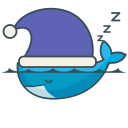
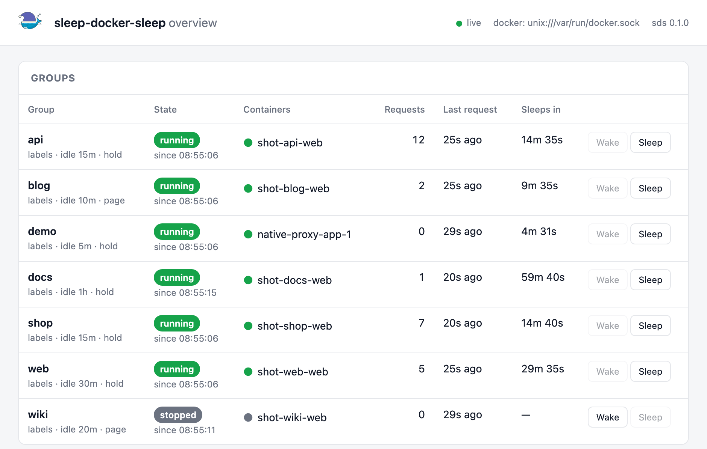

<p align="center">
  
</p>

<h1 align="center">sleep-docker-sleep</h1>

<p align="center">
  Scale idle Docker containers to zero and wake them on the first request.<br>
  One Rust binary, no changes to your applications, works with the reverse proxy you already run.
</p>

<p align="center">
  <a href="https://github.com/altipard/sleep-docker-sleep/releases"></a>
  <a href="https://github.com/altipard/sleep-docker-sleep/actions/workflows/ci.yml"></a>
  <a href="https://altipard.github.io/sleep-docker-sleep/"></a>
  <a href="https://github.com/altipard/sleep-docker-sleep/pkgs/container/sleep-docker-sleep"></a>
  <a href="LICENSE"></a>
</p>

---

`sds` watches the containers on a host. When a group of containers (a Compose project by
default) has not seen a request for a while, `sds` stops it. The next request starts it
again; the caller either waits a moment or sees a small "waking up" page. Made for hosts
that run many rarely used stacks: staging environments, customer demos, internal tools,
side projects.

```text
browser ──▶ reverse proxy ──(forward-auth: /_sds/check/shop)──▶ sds ──▶ docker start / stop
                 │                                                            │
                 └──────────────── request ────────────────▶ container group "shop" ◀┘
```

<p align="center">
  
</p>

**Key features**

- **Control plane only.** nginx, Caddy or Traefik ask `sds` before each request via their
  built-in forward-auth. `sds` never carries application traffic, so it cannot become a
  bottleneck, and with nginx a crash of `sds` fails open.
- **Label driven.** Containers opt in with `sds.enable=true`; a Compose project forms a
  group automatically. No central inventory to maintain, one daemon per host.
- **Graceful wake-up.** Requests are held until the group is healthy (Docker HEALTHCHECK,
  HTTP or TCP probe), or a self-refreshing waiting page is served. Bounded waiters, one
  start per group, no thundering herd.
- **Native proxy as a fallback.** For stacks without a reverse proxy and for TCP services
  such as databases, `sds` can own the public port itself (streaming, WebSocket aware).
- **Operator tooling included.** CLI, live terminal dashboard (`sds top` attaches to the
  running service), web overview with event log, JSON API and SSE stream, generated proxy
  snippets, systemd/launchd units.

## Contents

- [Installation](#installation)
- [Quick start](#quick-start)
- [Try it with the demo stack](#try-it-with-the-demo-stack)
- [Labels](#labels)
- [Usage with reverse proxies](#usage-with-reverse-proxies)
- [Operating it](#operating-it)
- [Documentation](#documentation)
- [How it compares](#how-it-compares)
- [Status](#status)
- [Development](#development)
- [License](#license)

## Installation

`sds` needs Docker Engine 20.10 or newer and access to the Docker socket. It runs on
Linux (systemd) and macOS (launchd).

**Release binary** (Linux x86_64/aarch64, macOS Apple Silicon/Intel):

```bash
curl -fsSLo sds https://github.com/altipard/sleep-docker-sleep/releases/latest/download/sds-linux-x86_64
sudo install -m 755 sds /usr/local/bin/sds
```

**Cargo** (Rust 1.85+):

```bash
cargo install --git https://github.com/altipard/sleep-docker-sleep --locked
```

**Container** (when your reverse proxy runs as a container too; set
`[admin] bind = "0.0.0.0:9900"` in the mounted `sds.toml`):

```bash
docker run -d --name sds \
  -v /var/run/docker.sock:/var/run/docker.sock \
  -v ./sds.toml:/etc/sds/sds.toml:ro \
  -p 127.0.0.1:9900:9900 \
  ghcr.io/altipard/sleep-docker-sleep:latest
```

> [!TIP]
> `sds check` verifies Docker access and lists the groups it would manage, without
> starting the daemon. Run it first.

## Quick start

1. Label a project and publish its port on loopback only:

   ```yaml
   services:
     app:
       image: ghcr.io/example/app:1.2.3
       ports: ["127.0.0.1:18080:8080"]
       labels:
         sds.enable: "true"
         sds.idle_timeout: "15m"
         sds.health: "http://127.0.0.1:18080/healthz"
   ```

2. Run the daemon and generate the proxy snippet:

   ```bash
   sds run                                       # dashboard; `sds service install` for production
   sds integrate nginx myproject --host app.example.com --upstream http://127.0.0.1:18080
   ```

   The command prints a ready-to-use `server` block (a Caddyfile block or Traefik
   middleware for the others). Reload the proxy.

3. Watch the cycle: `sds sleep myproject` stops the project, a browser reload wakes it.

> [!NOTE]
> One `sds` per host manages every labelled container on it. Two daemons on the same
> Docker socket would fight over the same groups.

## Try it with the demo stack

[`examples/demo`](examples/demo/README.md) starts ten tiny web servers with idle timeouts
between 20 and 60 seconds and a script that sends random requests through `sds`. Within a
minute the dashboard shows groups falling asleep, waking on a request and serving again.

```bash
cd examples/demo
docker compose up -d
sds run          # second terminal
./traffic.sh     # third terminal
```

## Labels

| Label | Default | Meaning |
|---|---|---|
| `sds.enable` | | `true` puts the container under management. |
| `sds.group` | Compose project | Containers with the same group start and stop together. |
| `sds.idle_timeout` | `15m` | Stop the group after this long without a request. |
| `sds.health` | `docker` | Readiness after a start: `docker` (HEALTHCHECK), `http://…`, `tcp://host:port`, `grace`. |
| `sds.wake` | `hold` | `hold` the first request until ready, or serve a waiting `page`. |
| `sds.keep_awake` | `false` | Never stop this group (databases shared by several stacks). |
| `sds.proxy.listen` | | Let `sds` own a public port itself, see [native proxy](docs/handbook/native-proxy.md). |

Defaults live in `sds.toml`; labels override them per group. The full list is in the
[labels chapter](docs/handbook/labels.md).

## Usage with reverse proxies

The proxy asks `GET /_sds/check/<group>` before each request. `200` means go ahead; while
a group wakes up `sds` either holds the request or answers with the waiting page.

**nginx** on the host ([example](examples/nginx-host/))

```bash
sds integrate nginx shop --host shop.example.com --upstream http://127.0.0.1:18080
```

Uses `auth_request`. If `sds` is down, the `error_page 500 502` fallback bypasses it: the
site stays up, only sleeping stops.

**Caddy** on the host or in the project ([examples](examples/caddy-host/))

```bash
sds integrate caddy shop --host shop.example.com --upstream http://127.0.0.1:18080
```

Uses `forward_auth`. Caddy has no fail-open for forward-auth; run `sds` as a supervised
service with automatic restart.

**Traefik** per project or central ([examples](examples/traefik-central/))

```bash
sds integrate traefik shop --upstream http://shop:8080 --sds-url http://sds:9900
```

Prints the `forwardAuth` middleware as labels. Same fail-open caveat as Caddy.

Details and the exact snippets are in the [reverse proxy chapter](docs/handbook/reverse-proxy.md).

## Operating it

| Tool | What it gives you |
|---|---|
| `sds run` | The daemon with a live terminal dashboard; `x` detaches, the daemon keeps running. |
| `sds top` | Attach the dashboard to a running daemon, wake or sleep groups with `w` and `s`. |
| `http://127.0.0.1:9900/` | Web overview with group states, counters and the event log. |
| `sds status`, `sds wake`, `sds sleep` | Scripting and quick checks; `--json` for machines. |
| `/api/v1/status`, `/api/v1/events` | JSON API and server-sent events for your own tooling. |
| `sds service install` | Writes the systemd unit or launchd plist. |

## Documentation

The [handbook](https://altipard.github.io/sleep-docker-sleep/) covers installation,
the configuration reference, labels and groups, per-proxy integration, the native proxy,
operations, troubleshooting, the HTTP API, limitations and the architecture. The source is
in [`docs/handbook`](docs/handbook/README.md).

## How it compares

| | sleep-docker-sleep | Sablier | Lazytainer |
|---|---|---|---|
| Integration | forward-auth of nginx/Caddy/Traefik, or native proxy | proxy plugins (Traefik, Caddy, nginx, …) | own proxy / iptables |
| Discovery | container labels, Compose project = group | proxy configuration per route | labels |
| Wake behaviour | hold or waiting page, bounded waiters | waiting page themes | hold |
| Health gating | Docker HEALTHCHECK, HTTP, TCP, grace | container running | TCP |
| Operator UI | CLI, TUI, web overview, API | none | none |
| Language | Rust | Go | Go |

The design goal was production stability on hosts with a mix of host-level and
per-project proxies, which is why `sds` stays out of the data path by default. See
[Limitations](docs/handbook/limitations.md) for the honest list of what it does not do.

## Status

Early release. The state machine, discovery, API and proxy snippets are covered by tests;
the end-to-end path (`just smoke`) runs against a real Docker daemon. Used on Linux hosts
with systemd and on macOS with Docker Desktop. Feedback and issues are welcome.

## Development

```bash
just            # lint, test, build
just smoke      # end-to-end check against real Docker
just docs-serve # handbook with live reload (mdBook)
```

Rust 1.85+ and [just](https://just.systems) are the only tools needed. Examples for host
nginx and Caddy, project and central Traefik, the native proxy and the demo stack live
under [`examples/`](examples/README.md). Commits follow Conventional Commits; releases are
cut automatically from `main`.

## License

MIT, see [`LICENSE`](LICENSE).

The logo is a derivative of the Docker whale, which is a trademark of Docker, Inc., and is
used solely to indicate that this project works with Docker. This project is not
affiliated with or endorsed by Docker, Inc.
